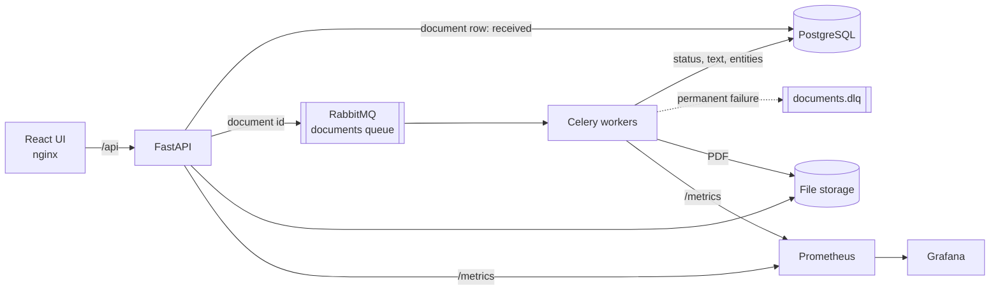

# DocIntake

[](https://github.com/LucaDepetris2/DocIntake/actions/workflows/ci.yml)

Document intake automation for U.S. law firms (litigation / personal injury).
DocIntake receives legal and medical PDFs, extracts their text (with OCR for scans),
classifies them, extracts entities, matches each one to the right case and files it
following the firm's rules. Anything it isn't sure about goes to a human review queue.
Deadlines found in documents (discovery responses, hearings) become alerts.

> All documents in this project are **synthetic** (generated by `scripts/generate_fake_docs.py`).
> No real PHI is ever stored.

## Highlights

- **Async pipeline** — FastAPI publishes to RabbitMQ; Celery workers run five chained stages.
  Messages carry only a document id; state lives in Postgres.
- **Reliability** — transient errors retried with exponential backoff + jitter; permanent
  failures mark the document `failed` and are dead-lettered to `documents.dlq`.
- **Idempotency** — content-hash upload dedup, compare-and-set status transitions
  (`UPDATE … WHERE status = :expected`), unique constraints on side effects. Proven with an
  8-thread race test against real Postgres.
- **Multi-tenant** — JWT carries `firm_id`; every query is scoped by it; cross-tenant access
  returns 404.
- **Human in the loop** — low classification or match confidence → `needs_review`, with the
  pipeline's best guess pre-filled for the reviewer.
- **Observability** — JSON logs (structlog) with a correlation id that follows an upload
  from the HTTP request through every Celery task; PHI fields redacted; Prometheus metrics
  and a provisioned Grafana dashboard.
- **Quality** — 127 tests (unit + integration on real Postgres via testcontainers), strict
  mypy, ruff, pre-commit, GitHub Actions.

## Architecture



Pipeline (one Celery task per stage, chained):

```
received → text_extracted → classified → entities_extracted → matched → filed
               │                 │                                │
               └──── needs_review (no text / low confidence / uncertain match) ────┘
any stage ──(error after retries)──► failed ──(manual retry)──► received
```

More detail in [docs/architecture.md](docs/architecture.md) and the
[architecture decision records](docs/adr/).

## Quick start

Requirements: Docker, [uv](https://docs.astral.sh/uv/), Node 22 (only for frontend dev).

```bash
cp .env.example .env
uv run --project backend python scripts/generate_fake_docs.py      # synthetic PDFs + matters
(cd backend && uv run python -m app.cli.train --data ../scripts/output)  # train the classifier
docker compose up -d --build
docker compose --profile demo run --rm seed                         # firms, matters, demo users
```

| Service | URL | Credentials |
|---|---|---|
| Web UI | http://localhost:8080 | `paralegal@harbor-law.test` / `$SEED_PASSWORD` |
| API docs | http://localhost:8000/docs | same (Authorize button) |
| Grafana | http://localhost:3000 | anonymous view, `admin` / `$GRAFANA_ADMIN_PASSWORD` |
| Flower | http://localhost:5555 | `$FLOWER_BASIC_AUTH` |
| RabbitMQ | http://localhost:15672 | `$RABBITMQ_DEFAULT_USER` / `$RABBITMQ_DEFAULT_PASS` |
| Prometheus | http://localhost:9090 | — |

Then upload PDFs from the UI, or run the end-to-end benchmark:

```bash
SEED_PASSWORD=docintake-demo uv run --project backend python scripts/benchmark.py
```

## Benchmark

500 synthetic documents per run, each worker container with 2 prefork processes, on a
16-core laptop (Docker Desktop). Throughput is measured server-side (first upload → last
document finished, from DB timestamps).

| Workers | Throughput | Wall time | Speed-up |
|---:|---:|---:|---:|
| 1 | 14.0 docs/s | 33.5 s | 1.0× |
| 2 | 24.7 docs/s | 19.1 s | 1.8× |
| 4 | 34.7 docs/s | 13.7 s | 2.5× |

Scaling is sub-linear and the data shows why: with 4 workers processing finishes ~4 s after
the last upload, so the bottleneck has moved to ingestion (a single uvicorn process, which
also slows down as workers compete for CPU and the database). Next step would be running the
API with several uvicorn workers.

Accuracy on the same runs: document type 100%, auto-filed documents matched to the correct
case 100%, ~6% routed to human review. These numbers are optimistic — documents come from
templates — which is exactly why the review queue and confidence thresholds exist.

## Development

```bash
cd backend
uv sync && uv run pre-commit install
uv run ruff check . && uv run ruff format --check .
uv run mypy app tests
uv run pytest                 # integration tests use testcontainers (Docker) or pgserver
uv run uvicorn app.main:app --reload

cd ../frontend
npm install && npm run dev    # http://localhost:5173, proxies /api to :8000
```

## Repository layout

```
backend/
  app/api/            FastAPI routers (auth, documents, review, firm, health/metrics)
  app/domain/         pure business logic: states, classification, entities, matching,
                      rules, deadlines (no infrastructure imports, fully unit-tested)
  app/db/             SQLAlchemy models and repositories
  app/workers/        Celery app, tasks and the pipeline stages
  app/processing/     PDF text extraction (pdfplumber + Tesseract OCR)
  app/observability/  logging, correlation id, metrics
  alembic/            migrations
  tests/              unit/ and integration/
frontend/             React + TypeScript UI (Vite, served by nginx)
infra/                Prometheus and Grafana provisioning
scripts/              synthetic document generator, benchmark
docs/                 architecture, ADRs, deploy guide, demo script
```
