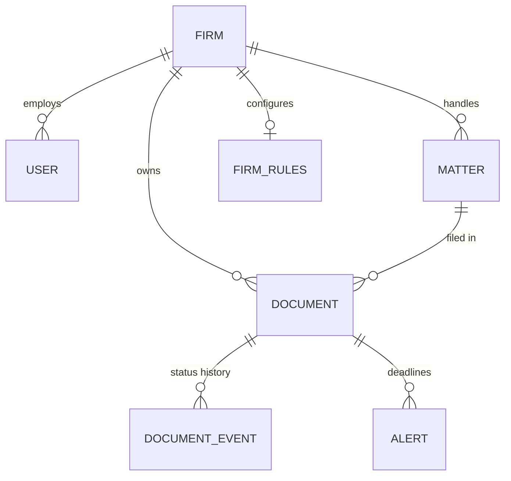

# Architecture

## Components

| Component | Role |
|---|---|
| **FastAPI** (`backend/app/api`) | Auth (JWT), upload, listing, review, rules, alerts, `/health`, `/metrics`. Validates PDFs (content type + `%PDF-` signature + size), stores the file, creates the `Document` row and publishes the pipeline **after** the DB commit. |
| **PostgreSQL** | Source of truth: firms, users, matters, documents (status, text, entities as JSONB), status events (audit trail), firm rules, alerts. Schema managed by Alembic. |
| **RabbitMQ** | Transports only document ids. Queue `documents` has a dead-letter exchange → `documents.dlq`. |
| **Celery workers** (`backend/app/workers`) | One task per pipeline stage, chained. Tasks are thin wrappers over plain functions in `stages.py`. |
| **File storage** | Local volume, content-addressed per firm: `<firm_id>/<sha256>.pdf`. |
| **React UI** (`frontend/`) | Inbox, review queue, document detail with PDF preview, deadlines. Served by nginx, which also proxies `/api`. |
| **Prometheus + Grafana** (`infra/`) | Scrape API and workers; provisioned dashboard. |

## Request → filed: the life of a document

1. `POST /documents` (JWT → firm). The file is hashed; if the firm already has that hash the
   existing document is returned (`duplicate: true`) and nothing is enqueued.
2. A `Document` row is created in `received` with a `DocumentEvent`, committed, and then
   `chain(extract_text, classify, extract_entities, match, file)` is published.
3. Each task loads the document, checks it is in the status the stage expects, does its
   work and moves it forward with a compare-and-set update. If a stage sends the document to
   `needs_review`, it also stops the rest of the chain.
4. `file` applies the firm's rules (file name, folder, assignee), computes deadlines and
   creates alerts, and sets `filed`.
5. A human resolves `needs_review` documents in the UI (`POST /documents/{id}/review`),
   which moves them to `matched` and enqueues only the `file` stage.

## Pipeline stages

| Stage | Logic (pure, in `app/domain` or `app/processing`) | Goes to review when |
|---|---|---|
| extract_text | pdfplumber per page; Tesseract OCR for pages without a text layer | no readable text |
| classify | TF-IDF + logistic regression, keyword rules as fallback ([ADR 0002](adr/0002-classifier-sklearn-with-rules-fallback.md)) | confidence < 0.6 |
| extract_entities | regex + dateutil: case numbers, parties, people, providers, labelled dates, amounts | — |
| match | exact case number = 1.0; otherwise weighted fuzzy name similarity (rapidfuzz) + defendant + incident date; ambiguity check | score < 0.85 or top two candidates within 0.05 |
| file | firm rules (validated JSON) + deadline rules → alerts | — |

## Reliability

- **At-least-once delivery, exactly-once effect.** `acks_late` + `prefetch=1`: a message is
  acknowledged only after the task finishes, so a crashed worker's message is redelivered.
  Redelivery is harmless because every stage is idempotent:
  - stage guard: the document must be in the expected status, otherwise the task is a no-op;
  - compare-and-set: `UPDATE documents SET status=:next WHERE id=:id AND status=:expected`;
    only one concurrent worker can win (tested with 8 racing threads on Postgres);
  - side effects are unique: `UNIQUE(firm_id, sha256)` for uploads,
    `UNIQUE(document_id, kind)` for alerts.
- **Retries** only for transient errors (DB/broker connectivity, timeouts): exponential
  backoff with jitter, `max_retries=3`. Retries are new messages, so they never hit the DLQ.
- **Permanent failures** (e.g. a corrupt PDF) mark the document `failed` with a sanitized
  error and the message is *rejected*; RabbitMQ dead-letters it to `documents.dlq`
  (`task_acks_on_failure_or_timeout=False`). Workers declare the DLQ at startup without
  consuming it. `POST /documents/{id}/retry` re-runs a failed document.

## Multi-tenancy

See [ADR 0003](adr/0003-multi-tenancy-row-level-scoping.md). The tenant comes from the
authenticated user (JWT `firm_id`, checked against the user row on every request); every
repository function takes a `firm_id`; resources from another firm return 404.

## Observability

- **Logs**: one JSON object per line (structlog), for our code and for uvicorn/Celery/
  SQLAlchemy alike. `correlation_id` is taken from `X-Correlation-ID` (validated) or
  generated, returned in the response, copied into Celery message headers on publish
  (`before_task_publish`) and restored in the worker (`task_prerun`) — so one id follows an
  upload through all stages. Keys that may contain PHI or secrets are redacted.
- **Metrics**: `http_requests_total`, `http_request_duration_seconds` (labelled by route
  template, not raw path), `pipeline_stage_runs_total{stage,outcome}`,
  `pipeline_stage_duration_seconds`, and `docintake_documents{status}` read from Postgres at
  scrape time. Workers use prometheus_client multiprocess mode (prefork children).

## Data model

